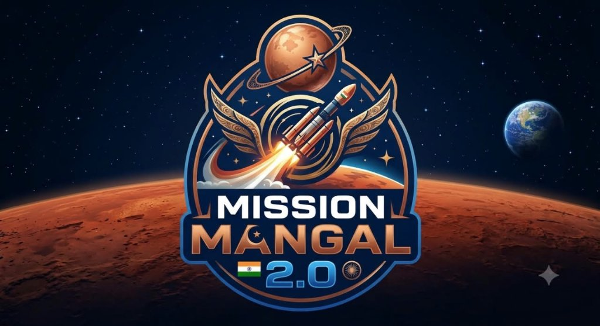

# Mangal Health Sentinel 🚀
### Autonomous Offline-First AI Health Monitoring System for Long-Duration Mars Missions
**Team Mission Mangal 2.0 · Nagpur, India**  
*NASA Space Apps Challenge: "Create Health Monitoring Software for Astronauts on Space Missions"*



---

## 🌟 Executive Summary

During an interplanetary voyage to Mars (180 days one-way, 3-year total mission duration), crew members endure extreme physiological stressors: microgravity cardiovascular deconditioning, trabecular bone mineral resorption, cephalad fluid shift inducing Spaceflight Associated Neuro-ocular Syndrome (SANS), high-energy cosmic ionizing radiation, and psychological confinement. Compounding these perils, electromagnetic communication between Mars and Earth suffers a **20-minute one-way light delay** (up to 44 minutes round-trip) and can be completely severed for weeks during solar conjunction.

**Mangal Health Sentinel**, engineered by **Team Mission Mangal 2.0 (Nagpur, India)**, is a mission-grade, edge-computing physiological monitoring and autonomous clinical decision-support system. Operating **100% locally on spacecraft avionics and portable crew tablets with zero cloud dependencies**, Mangal Health Sentinel couples an autonomous rule-based clinical triage engine, Web Crypto PBKDF2 authentication, and procedural 3D WebGL visualizations with real-time biometric drift detection.

---

## 🎨 Branding & Visual Identity

- **Official Mission Emblem**: Displayed across the 3D cinematic splash, terminal login, HUD header, PWA icons, and exported clinical reports.
- **Color Palette (Derived from Emblem)**:
  - Deep Space Navy (`#070B1F` / `#0A112C`): Spacecraft avionics background
  - Mars Copper / Rust (`#C8693A`, `#E8894F`): Mission accents and primary action vectors
  - Glowing Blue (`#2E8BFF`, `#00C2FF`): HUD telemetry and optical waveforms
  - Sun Gold (`#F2B44C`): Critical benchmarks and helmet visor reflections
  - Status Indicators: Teal (`#10B981`, nominal), Amber (`#F59E0B`, watch), Red (`#EF4444`, critical)
- **Typography**:
  - Headings: **Orbitron** / **Rajdhani** futuristic aerospace display typography
  - Body: **Inter** readable sans-serif, with offline local system fallbacks
- **Footer**: `Team Mission Mangal 2.0 · Nagpur, India` displayed across all views and report headers.

---

## 🏛 System Architecture

```
Mangal Health Sentinel (Team Mission Mangal 2.0)
│
├── 3D WebGL Procedural Visuals (Three.js)
│   ├── CinematicLandingScene.jsx   # Procedural bump-mapped Mars sphere + Earth + Rocket
│   ├── AstronautBodyScanner3D.jsx   # Low-poly astronaut with 6 pulsing biometrics hotspots
│   ├── SpacecraftModuleMap3D.jsx    # Module cutaway with storm shelter path & screen shake
│   └── MissionTrajectory3D.jsx      # Heliocentric Hohmann transfer orbit with Sol marker
│
├── Security & Access Layer (Web Crypto API + idb)
│   ├── hash.js                      # PBKDF2 100k salted hash + AES-GCM 256-bit journal cipher
│   ├── db.js                        # IndexedDB (users, sessions, consent, audit_logs)
│   ├── session.js                   # 5-min inactivity lock, 5-attempt lockout, token management
│   ├── rbac.js                      # 4-role permissions matrix & Route Guards
│   ├── consent.js                   # Astronaut-governed data-access enforcement
│   └── audit.js                     # Immutable security and access event ledger
│
├── Physiological & Autonomous Engines
│   ├── simulator.js                 # Microgravity adaptation equations (Day 1-180)
│   ├── anomaly.js                   # Z-score (|Z| >= 1.8σ) personal baseline drift engine
│   ├── triage.js                    # 10 rule-based spaceflight protocols + Web Speech API
│   ├── rppg.js                      # Webcam remote photoplethysmography (forehead ROI)
│   └── audio.js                     # Web Audio API alert sirens, heartbeats, and pings
│
└── User Interface HUD
    ├── Navbar.jsx                   # Mission status, role badge, break-glass trigger, PIN lock
    ├── MissionSimulatorBar.jsx      # Day slider, 1x/5x/15x speeds, 3D orbit toggle, event triggers
    ├── RadialHealthGauge.jsx        # 0-100 score arc with "Why this score?" breakdown
    ├── DashboardPage.jsx            # 7 live sparkline cards + 3D Body Scanner
    ├── SolarFlareModal.jsx          # SPE red alert vignette + 3D module shelter map
    └── PinUnlockModal.jsx           # Glove-friendly quick numeric unlock
```

---

## 🔐 Authentication, Authorization & Security

### 1. Cryptographic Security Standards
- **PBKDF2 Password Hashing**: Passwords are never stored in plaintext. They are salted with a 16-byte cryptographically secure random salt (`crypto.getRandomValues`) and stretched through **100,000 iterations of SHA-256**.
- **Journal Encryption at Rest**: Private subjective astronaut notes are encrypted in IndexedDB using **256-bit AES-GCM**, derived from the user's passphrase.
- **Glove-Friendly PIN Pad**: Auto-locks after 5 minutes of inactivity; large 64px numeric touch targets allow astronauts wearing pressurized gloves to quickly unlock with a 4-digit PIN (`1234`).
- **Brute-Force Lockout Defense**: 5 consecutive failed login attempts trigger an autonomous **30-second security cooldown lockout**.

### 2. Role-Based Access Control (RBAC) Matrix

| Feature / Subsystem | Astronaut | Flight Surgeon | Mission Commander | Ground Admin |
| :--- | :---: | :---: | :---: | :---: |
| **Personal Dashboard & Vitals** | ✅ Full | ✅ Full | ✅ Full | ✅ Full |
| **Drift Anomaly Z-Score Matrix** | ✅ Full | ✅ Full | ❌ Blocked | ✅ Full |
| **NASA 5-Hazards Radar** | ✅ Full | ✅ Full | ✅ Full | ✅ Full |
| **AI Flight Surgeon Triage** | ✅ Full | ✅ Full | ❌ Blocked | ✅ Full |
| **Medical Kit Inventory CRUD** | ✅ Full | ✅ Full | ✅ View Only | ✅ Full |
| **Contactless Vitals Scan (rPPG)** | ✅ Full | ✅ Full | ❌ Blocked | ✅ Full |
| **Cognition & PVT Reaction Trials** | ✅ Full | ⚠️ Consent-Gated* | ❌ Blocked | ✅ Full |
| **Private Encrypted Journal** | ✅ Full | ⚠️ Consent-Gated* | ❌ Blocked | ❌ Blocked |
| **Adaptive Exercise Prescriptions** | ✅ Full | ✅ Full | ✅ Full | ✅ Full |
| **Delay-Tolerant Earth Sync** | ✅ Full | ✅ Full | ✅ Full | ✅ Full |
| **Crew Telemetry & Fatigue Scheduler** | ✅ Full | ✅ Full | ✅ Full | ✅ Full |
| **Consent Center** | ✅ Full | ❌ Blocked | ❌ Blocked | ✅ Full |
| **Admin Panel & Audit Trail** | ❌ Blocked | ❌ Blocked | ❌ Blocked | ✅ Full |

*\*Note: If the astronaut has restricted Mental Health or Journals under the Consent Center, the Flight Surgeon can only view them by activating a documented **Emergency Override (Break-Glass)** requiring a typed clinical justification.*

### 3. Seeded Demonstration Accounts

The terminal login screen includes a **"Demo Access"** one-click filler panel pre-loaded with four accounts:
- **Astronaut**: `astronaut@mangal.in` (Passphrase: `Mangal@123` | PIN: `1234`)
- **Flight Surgeon**: `surgeon@mangal.in` (Passphrase: `Mangal@123` | PIN: `1234`)
- **Mission Commander**: `commander@mangal.in` (Passphrase: `Mangal@123` | PIN: `1234`)
- **Ground Admin**: `admin@mangal.in` (Passphrase: `Mangal@123` | PIN: `1234`)

> **[!] Security Note**: *This implementation demonstrates production-grade client-side cryptographic patterns (Web Crypto PBKDF2/AES-GCM, IndexedDB, and RBAC). In an operational NASA orbital flight deployment, authentication tokens would be synchronized with spacecraft hardware security modules (HSM) and TLS 1.3 encrypted ground station conduits.*

---

## 🌌 3D & WebGL Visual Systems

All 3D models and textures are generated **procedurally in Three.js** with zero external network downloads:
1. **Cinematic Landing & Splash**:
   - Rotating procedural Mars sphere with crater bump map and atmospheric scattering rim shader
   - Distant Earth sphere with continents and cloud deck
   - Parallax starfield shifting with mouse / device gyroscope movement
   - Orbital rocket with particle exhaust flame trail
2. **Interactive 3D Astronaut Body Scanner**:
   - Rotatable low-poly space suit model
   - 6 pulsating diagnostic hotspots (Heart, Eyes/SANS, Bones, Brain, Immune, Radiation)
   - Color shifts dynamically based on live vitals (Emerald, Amber, Red)
   - Clicking any hotspot focuses the camera and displays clinical trend guidance
3. **3D Spacecraft Module Radiation Map**:
   - Rotatable orbital transfer spacecraft showing modular compartments
   - During a **Solar Flare**: red alert vignette, screen shake, and an animated pulsating arrow guiding the crew to **Module 04 (Water-Shielded Storm Shelter Vault)**
4. **3D Heliocentric Trajectory**:
   - Solar system orbital plane displaying Earth orbit, Mars orbit, and the Hohmann transfer arc
   - Spacecraft beacon advances dynamically as the Mission Day slider moves from Day 1 to Day 180!

---

## 🩺 Core Physiological Features

1. **Mission Simulator**: 180-sol timeline with 1x, 5x, 15x speeds and contingency injections (Solar Flare, Chest Pain, Comm Blackout, Crew Conflict).
2. **Health HUD & Radial Gauge**: Composite health score ($0-100$) with transparent *"Why this score?"* modal and 7 live Recharts sparkline cards.
3. **Personal Baseline Drift**: Evaluates individual variance ($|Z| \ge 1.8\sigma$) against pre-flight baselines (Resting HR deconditioning, SANS cephalic fluid shift, bone mineral loss).
4. **NASA 5-Hazards Radar**: Synthesizes Radiation, Skeletal/Muscle, Cardio/SANS, Immune Dysregulation, and Isolation Stress.
5. **Offline AI Flight Surgeon**: 10 clinical spaceflight protocols with voice input and spoken replies (Web Speech API), cross-referencing on-board medication inventory.
6. **Medical Kit Inventory**: Stock quantities, expiry tracking, out-of-stock alternative recommendations, and one-click dispense.
7. **Contactless Vitals Scan (rPPG)**: Webcam-based forehead green channel absorption pulse wave extraction with live oscilloscope canvas and synthetic fallback.
8. **Mind & Cognition**: 60-second Psychomotor Vigilance Test (PVT-192), mood circumplex check-in, AES-GCM encrypted private journal, and animated 4s box-breathing.
9. **Adaptive Exercise Prescription**: Tailors daily ARED resistance loads and T2 treadmill intervals based on bone resorption and fatigue.
10. **Delay-Tolerant Earth Sync**: 20-minute light delay simulation, severity-sorted DTN packet queue, and branded PDF/JSON clinical report export.
11. **Crew View & Fatigue-Aware Scheduler**: 4-astronaut telemetry with safety interlock blocking safety-critical tasks (EVA spacewalks) for sleep-deprived crew.
12. **Alerts Center**: Prioritized notifications with synthesized Web Audio alarms and vibration triggers.

---

## 🎬 3-Minute Demo Script

Follow this step-by-step walkthrough to present Mangal Health Sentinel:

1. **Minute 1: Splash, Astronaut Login & Baseline Drift (0:00 - 1:00)**
   - Open `http://localhost:3000`. Admire the 3D procedural Mars globe, rocket trail, and Mission Mangal 2.0 emblem.
   - Click *"Initialize Sentinel HUD"*.
   - On the login screen, click **"1. Astronaut"** (fills `astronaut@mangal.in`), and click *"Authenticate Terminal Access"*.
   - On the HUD, drag the **Mission Day** slider from Sol 1 to **Sol 120 (or hit PLAY 15x)**.
   - Notice the resting heart rate rise to 74 bpm, bone density drop to -4.1%, and cephalad fluid shift index increase to +1.82$\sigma$.
   - Click on the **3D Astronaut Body Scanner**: click the **Heart** and **Eyes (SANS)** hotspots to inspect specific microgravity deconditioning metrics.
   - Click *"Why this score?"* on the radial gauge to review the clinical penalty deductions.

2. **Minute 2: Solar Flare, Comm Blackout & Chest Pain Emergency (1:00 - 2:00)**
   - On the simulator bar, click **"Solar Flare"**.
   - An emergency audio klaxon siren sounds, screen shake activates, and the **3D Spacecraft Module Map** opens!
   - Observe the animated green arrow pointing directly into **Module 04: Water Storm Shelter**.
   - Click *"SEAL & ENTER STORM SHELTER"* to secure the crew and attenuate ambient radiation by 98%.
   - Now click **"Chest Pain"** and **"Blackout"** simultaneously on the simulator bar.
   - Navigate to **AI Surgeon**: click the quick prompt *"Acute chest pressure with pain radiating to left shoulder"*.
   - The offline triage engine runs with zero internet access, prescribes Chewable Aspirin from Med Kit Alpha, notes unavailable items with in-stock alternatives, and queues a `CRITICAL` telemetry packet into the DTN buffer.

3. **Minute 3: Consent Restraints, Break-Glass & Admin Audit Trail (2:00 - 3:00)**
   - Lock or logout of the terminal. Login as **"2. Flight Surgeon"** (`surgeon@mangal.in`).
   - Navigate to **Mind & PVT**: notice access to private journals and mental health telemetry is **RESTRICTED BY ASTRONAUT CONSENT**.
   - In the top navbar, click **"Emergency Override"**. Type justification: *"Astronaut acute chest pain emergency during communication blackout; reviewing cognitive baseline"*, and execute Break-Glass.
   - Access is immediately granted and flagged with a red alert banner.
   - Logout and login as **"4. Ground Admin"** (`admin@mangal.in`).
   - Open **Admin Ledger**: inspect the immutable IndexedDB security audit trail displaying the login, the consent update, and the emergency break-glass override with timestamps!

---

## 🚀 Installation & Local Execution

```bash
# Navigate to the project root directory
cd "Mission Mangal 2.0"

# Install dependencies (React 18, Vite, Three.js, Recharts, Zustand, idb)
npm install

# Start local development server
npm run dev
```

Open your browser at: **`http://localhost:3000`**

To verify a production build:
```bash
npm run build
```

---

## 👥 Team & Acknowledgments

- **Team Name**: Mission Mangal 2.0
- **Location**: Nagpur, Maharashtra, India
- **Hackathon**: NASA International Space Apps Challenge
- **Challenge Title**: "Create Health Monitoring Software for Astronauts on Space Missions"

*Proudly developed in Nagpur, India for humanity's next giant leap to Mars.*
# Mission-Mangal-2.0

