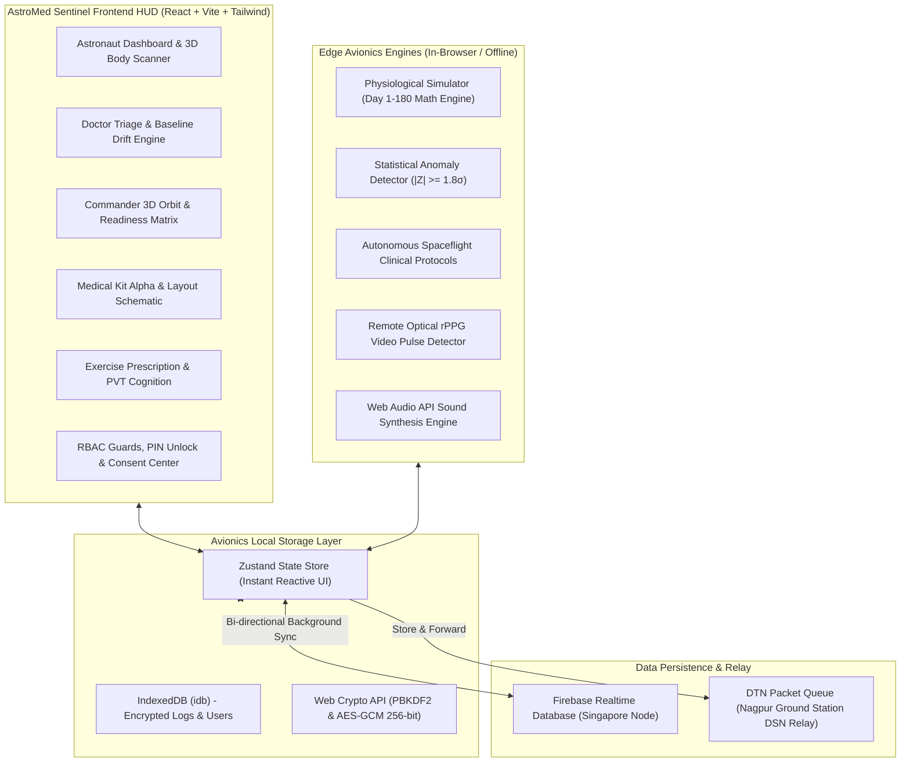

# 🚀 Mission Mangal 2.0 · AstroMed Sentinel
### Autonomous Spaceflight Physiological Monitoring & Clinical Decision Support System

<p align="center">
  
</p>

<p align="center">
  <strong>Engineered by Team Mission Mangal 2.0 · Nagpur, Maharashtra, India 🇮🇳</strong><br />
  <em>Designed for deep-space interplanetary voyages with extreme communication latency.</em>
</p>

<p align="center">
  
  
  
  
  
  
</p>

---

## 🌌 The Mission Challenge

During an interplanetary voyage to Mission (like 180 days one-way; 3-year total mission cycle), astronauts face an unforgiving environment:
- **Cardiovascular & Orthostatic Deconditioning:** Microgravity causes blood and body fluids to shift cephalad (headward).
- **Spaceflight-Associated Neuro-ocular Syndrome (SANS):** Increased intracranial pressure causes optic disc swelling and vision changes.
- **Bone & Muscle Loss:** Trabecular bone resorption (1.0%–1.5% per month) and musculoskeletal atrophy.
- **Ionizing Space Radiation:** Cosmic rays and sudden Solar Particle Events (SPEs) deliver life-threatening ionizing doses.
- **Extreme Telemetry Latency:** Earth-Mars radio signals endure a **20-minute one-way light delay** (up to 44 minutes round-trip), rendering real-time telemedicine from Earth impossible. During solar conjunction, communication is completely severed for weeks.

**AstroMed Sentinel** provides an autonomous, avionics-grade clinical operations system that functions 100% locally on crew tablets and spacecraft workstations, synchronizing opportunistically with Earth ground control.

---

## ✨ Key Features & Capabilities

### 🩺 1. Astronaut Health Dashboard
- **Biometric Telemetry HUD:** Real-time pulse, blood pressure, SpO₂, core temperature, hydration, and bone density metrics.
- **3D Interactive Body Scanner:** WebGL astronaut model with pulsing anatomical hotspots (Heart, Lungs, Brain, Eyes, Bone Structure, Liver) linked to physiological diagnostic filters.
- **Radial Health Index (0–100):** Real-time composite score with drill-down breakdown of individual risk penalties.
- **Contactless rPPG Camera Scanner:** Uses webcam computer vision and facial region-of-interest (ROI) photoplethysmography to measure heart rate without physical sensors.

### 👨‍⚕️ 2. Doctor / Flight Surgeon Review
- **Multi-Crew Triage Board:** Real-time crew vitals with status color-coding (Nominal, Watch, Critical).
- **Baseline Drift Detection:** Automated Z-score statistical monitoring (|Z| ≥ 1.8σ) comparing current metrics against astronaut pre-flight baselines.
- **7-Day Risk Heatmap:** Multi-hazard risk matrix tracking individual exposure to microgravity, radiation, hypoxia, and fatigue.
- **Radiation Transit Gauge:** Live tracking against the 250 mSv safe mission threshold.
- **Privacy Enforcement:** Mental health and private sleep journals are shielded until explicitly unsealed by astronaut consent or emergency override.

### 🎖️ 3. Commander Mission Operations
- **3D Heliocentric Hohmann Transfer Orbit:** Dynamic WebGL orbital trajectory featuring textured celestial bodies (Sun, Earth, Mars) and a moving spacecraft positioned along the 180-Sol flight path.
- **Crew Readiness Matrix:** High-level readiness indices (Fit, Caution, Unfit) preserving clinical privacy while detailing mission fitness, fatigue, and 7-day sleep duration.
- **Tactical Gantt Timeline:** Task assignment view with automatic fatigue and stress warning badges.
- **Emergency Orders Protocol:** Instant action commands for Storm Shelter Evacuation, Mandatory Crew Rest, and DTN Communication Checks.

### 🛡️ 4. Admin Control Room & Cryptographic Ledger
- **Telemetry Relay Map:** Nagpur Deep Space Ground Station (Nagpur DSN ↔ Spacecraft) radio link monitor with live signal transit delay calculation.
- **System Health Gauges:** Avionics memory allocation, client IndexedDB storage, and offline telemetry buffer metrics.
- **Cryptographic Audit Log:** Tamper-evident ledger logging authentication events, consent toggles, and emergency overrides.
- **Identity & Role Management:** Quick toggle access controls and role-based privilege assignments.

### 💊 5. Medical Kit Alpha (Autonomous Inventory)
- **3D Med Kit Case:** Interactive Three.js open kit visualization with glowing compartment slots.
- **Smart Stock Rings & Expiry Bars:** Visual circular stock percentages and human-readable countdowns (*"Expires in 1 year 7 months"*).
- **Interactive Kit Layout Schematic:** Compartment grid highlighting locker locations (Slot 01, Emergency Tray, Bulkhead Bay, Galley Rack).
- **What This Treats Chips:** Clinical lookup linking available medications (Aspirin, Nitroglycerin, Ondansetron, Oxygen, Saline) to mission symptoms.
- **Offline Substitute Recommender:** Automatically suggests alternative therapies if a primary pharmaceutical is depleted.

### 🏋️ 6. Exercise & Countermeasure Protocols
- **Axial Resistance (ARED):** High-load squats and deadlifts targeting L1–L5 lumbar axial loading and femoral neck bone preservation.
- **Aerobic & Plasma Volume (T2 Treadmill):** Target heart rate zone intervals with harness bungee loading.
- **Workout Log:** Tracks session completion, caloric expenditure, and countermeasure volume.

### 🧠 7. Mind, Sleep & Cognition
- **Psychomotor Vigilance Task (PVT):** 60-second reaction time test tracking mean response time and attention lapses to measure fatigue.
- **Encrypted Mental Health Journals:** AES-GCM 256-bit encrypted journal entries stored locally in client IndexedDB.
- **Granular Consent Sharing:** Astronauts select whether journal summaries are *Private*, *Anonymized*, or *Full Telemetry*.

### ☢️ 8. Solar Particle Event (SPE) Shelter Evacuation
- **Radiation Alert System:** Automated audio-visual sirens when radiation dose rates exceed safe thresholds.
- **3D Spacecraft Module Cutaway:** Animated path guiding crew members to the radiation-shielded storm shelter (Module 04).
- **Shielding Physics:** Simulates a 92% attenuation of ionizing radiation inside the water-wall shelter.

### 📡 9. Delay-Tolerant Networking (DTN) Earth Sync
- **Store-and-Forward Queue:** Buffers telemetry packets during solar conjunction and communication blackouts.
- **Nagpur Ground Station Uplink:** Simulated telemetry bursts with realistic 20-minute transmission lags.

---

## 🏛 System Architecture



---

## 🔐 Security & Spaceflight Medical Privacy

- **Web Crypto PBKDF2 Authentication:** Passwords are salted with 100,000 iterations of SHA-256 and stored in IndexedDB.
- **AES-GCM 256-Bit Journal Encryption:** Private psychological reflections are encrypted with client keys.
- **Emergency Medical Break-Glass:** In life-threatening emergencies, medical officers can trigger a cryptographic override to access locked records; this event is irreversibly written to the immutable audit ledger.
- **Inactivity Auto-Lock & Glove-Friendly PIN:** Automatic lockout after 5 minutes of inactivity with a high-contrast touch/glove-friendly PIN pad.
- **Role-Based Access Control (RBAC):**
  | Role | Health Telemetry | Mental Health Records | Commander Readiness | Inventory Restock | Admin Ledger |
  | :--- | :---: | :---: | :---: | :---: | :---: |
  | **Astronaut** | Full (Self) | Full (Self) | View Only | View Only | ❌ |
  | **Doctor / Surgeon** | Full (All Crew) | Consent-Gated | View Only | Full | ❌ |
  | **Commander** | Readiness Index | ❌ | Full Management | View Only | ❌ |
  | **Ground Admin** | ❌ (No Health Data) | ❌ | ❌ | Full | Full Access |

---

## 🛠️ Technology Stack

| Domain | Technologies |
| :--- | :--- |
| **Frontend Framework** | [React 18](https://react.dev/) + [Vite 5](https://vitejs.dev/) |
| **State Management** | [Zustand](https://github.com/pmndrs/zustand) (with Local-First Reactive Slices) |
| **Styling & HUD UI** | [Tailwind CSS 3](https://tailwindcss.com/) + Custom Aerospace Glassmorphism HUD |
| **3D Graphics & WebGL** | [Three.js](https://threejs.org/) (Procedural Orbits, Astronaut Anatomy, Med Kit) |
| **Data Visualizations** | [Recharts](https://recharts.org/) + Handcrafted Animated Inline SVG Sparklines |
| **Cloud Synchronization**| [Firebase Realtime Database](https://firebase.google.com/) (Singapore `asia-southeast1`) |
| **Offline Storage** | IndexedDB via [`idb`](https://github.com/jakearchibald/idb) + LocalStorage |
| **Cryptographic Primitives**| Web Crypto API (`window.crypto.subtle`: PBKDF2, AES-GCM, SHA-256) |
| **Audio & Speech** | Web Audio API (procedural oscillator chimes & sirens) + Web Speech Synthesis |
| **Internationalization** | Multi-language engine supporting **English**, **Hindi (हिंदी)**, and **Marathi (मराठी)** |
| **Icons & Assets** | [Lucide React](https://lucide.dev/) + Custom Procedural SVG Aerospace Vectors |

---

## 📁 Repository Directory Structure

```text
Mission Mangal 2.0/
├── public/
│   ├── assets/                 # Mission emblems, logos, and UI illustration assets
│   ├── favicon.ico
│   └── robots.txt
├── src/
│   ├── auth/                   # Cryptographic authentication & access control
│   │   ├── audit.js            # Tamper-evident ledger logging
│   │   ├── consent.js          # Granular astronaut consent policies
│   │   ├── db.js               # IndexedDB database initialization
│   │   ├── hash.js             # PBKDF2 100k salted hashing & AES-GCM
│   │   ├── rbac.js             # 4-role permission matrix & route guards
│   │   └── session.js          # Inactivity locks, sessions & token management
│   ├── components/             # Reusable avionics HUD components
│   │   ├── BiometricDiagrams3D.jsx # Visual medical gauges & pharmacology diagrams
│   │   ├── EmergencyOverrideModal.jsx # Break-glass protocol modal
│   │   ├── ErrorBoundary.jsx   # Avionics fault recovery boundary
│   │   ├── LanguageSwitcher.jsx # EN / HI / MR language selector
│   │   ├── MissionSimulatorBar.jsx # Sol 1-180 time stepper & event injectors
│   │   ├── RadialHealthGauge.jsx # Circular composite health index
│   │   ├── Sidebar.jsx         # Responsive aerospace navigation drawer
│   │   ├── SolarFlareModal.jsx # Solar Particle Event emergency overlay
│   │   └── VisualCard.jsx      # High-contrast 3D tilt card container
│   ├── data/                   # Pre-seeded spaceflight reference datasets
│   │   ├── crew.json           # Crew astronaut baseline biometrics
│   │   └── inventory.json      # Medical Kit Alpha pharmaceutical stock
│   ├── i18n/                   # Multilingual localization
│   │   ├── LanguageContext.jsx # React Context for active language
│   │   └── translations.js     # Comprehensive dictionary (EN, HI, MR)
│   ├── pages/                  # Top-level application views
│   │   ├── AdminPanelPage.jsx  # Nagpur DSN & system ledger
│   │   ├── AlertsCenterPage.jsx# Mission alert notifications
│   │   ├── BaselineDriftPage.jsx # Z-score physiological deviation tracker
│   │   ├── BodyScanPage.jsx    # 3D interactive anatomical inspection
│   │   ├── CommanderOverviewPage.jsx # Orbital mechanics & crew readiness
│   │   ├── ConsentCenterPage.jsx # Astronaut data-sharing controls
│   │   ├── CrewViewPage.jsx    # Crew health overview
│   │   ├── DashboardPage.jsx   # Primary astronaut biometric HUD
│   │   ├── DoctorPatientReviewPage.jsx # Clinical diagnosis & triage
│   │   ├── EarthSyncPage.jsx   # Delay-Tolerant Networking telemetry buffer
│   │   ├── ExercisePage.jsx    # ARED & T2 countermeasure tracker
│   │   ├── FlightSurgeonPage.jsx # AI autonomous triage voice assistant
│   │   ├── InventoryPage.jsx   # Medical Kit Alpha tracking & restocking
│   │   ├── LandingPage.jsx     # 3D planetary intro splash
│   │   ├── LoginPage.jsx       # PBKDF2 biometric credentials terminal
│   │   ├── MindCognitionPage.jsx # PVT reaction test & encrypted journals
│   │   ├── MultiHazardRiskPage.jsx # 5 spaceflight risks matrix
│   │   ├── RadiationShelterPage.jsx # SPE shelter protocol & 3D module path
│   │   └── VitalsScanPage.jsx  # Contactless rPPG optical heart rate scan
│   ├── store/                  # Central state management
│   │   └── useMissionStore.js  # Zustand store with Firebase RTDB background sync
│   ├── three/                  # Three.js 3D WebGL scenes
│   │   ├── AstronautBodyScanner3D.jsx # Pulsing anatomical hotspot model
│   │   ├── AstronautBust3D.jsx # 3D helmeted astronaut avatar
│   │   ├── CinematicLandingScene.jsx # Planetary Mars/Earth flyby
│   │   ├── MissionTrajectory3D.jsx # Hohmann transfer orbit with Sol marker
│   │   └── SpacecraftModuleMap3D.jsx # Module cutaway shelter route
│   ├── utils/                  # Avionics math, sound, and sync engines
│   │   ├── anomaly.js          # Z-score statistical baseline analysis
│   │   ├── audio.js            # Web Audio API sound synthesizer
│   │   ├── firebaseHelpers.js  # Serialization, ID sanitization & list conversion
│   │   ├── rppg.js             # Webcam optical pulse wave extraction
│   │   ├── simulator.js        # Microgravity degradation formulas
│   │   ├── triage.js           # 10 aerospace clinical triage rules
│   │   └── webgl.js            # Hardware acceleration & WebGL verification
│   ├── App.jsx                 # Main application router & providers
│   ├── firebase.js             # Firebase SDK client initialization
│   ├── index.css               # Spacecraft avionics theme styling
│   └── main.jsx                # Application root entrypoint
├── .env                        # Local development environment configuration
├── package.json                # Project dependencies and npm scripts
├── tailwind.config.js          # Aerospace theme configuration
└── vite.config.js              # Vite bundling, manual chunks & port setup
```

---

## 🚦 Getting Started

### Prerequisites
- [Node.js](https://nodejs.org/) (version 18.0.0 or higher)
- [npm](https://www.npmjs.com/) (version 9.0.0 or higher)
- A modern web browser with WebGL enabled (Chrome, Edge, Firefox, or Safari)

### Installation

1. **Clone the repository:**
   ```bash
   git clone https://github.com/your-username/mission-mangal-2.0.git
   cd "Mission Mangal 2.0"
   ```

2. **Install project dependencies:**
   ```bash
   npm install
   ```

3. **Configure Environment Variables:**
   A `.env` file is included in the project root:
   ```env
   VITE_APP_TITLE=Mangal Health Sentinel
   VITE_PORT=3000
   VITE_APP_ENV=development
   VITE_API_URL=http://localhost:3000/api
   ```

4. **Start the Development Server:**
   ```bash
   npm run dev
   ```
   Open your browser at **`http://localhost:3000/`** (or the alternative port displayed in your terminal).

5. **Build for Production:**
   ```bash
   npm run build
   ```
   The optimized production bundle will be generated in the `/dist` directory.

---

## 🧪 Simulation & Testing Guide

AstroMed Sentinel includes a **Mission Simulator Control Bar** at the bottom of the interface to test real-time spaceflight scenarios:

| Control | Description |
| :--- | :--- |
| **Sol Day Slider (1 to 180)** | Advances the mission timeline to simulate physiological adaptation (muscle atrophy, bone deconditioning, cephalad fluid shift) over time. |
| **Simulation Speed** | Toggle between **1x**, **5x**, and **15x** time compression. |
| **SPE Solar Particle Event** | Triggers an emergency coronal mass ejection alert, starts the 18-minute evacuation countdown, sounds alarm sirens, and activates the 3D shelter evacuation route. |
| **Acute Chest Pain** | Simulates a critical cardiovascular event, triggering automated triage protocol **CP-01**, suggesting chewable Aspirin, sublingual Nitroglycerin, and oxygen delivery. |
| **Comm Blackout** | Simulates solar conjunction; switches the telemetry transceiver to offline and redirects all generated packets into the DTN store-and-forward buffer. |
| **Interpersonal Stress** | Simulates psychological confinement stress, elevating crew conflict scores and updating the behavioral health triage log. |

### Testing Firebase Cloud Sync
1. Open the **Medical Kit** page (`/inventory`).
2. Click **"- Consume"** on *Aspirin (Chewable)* — notice the stock decrements instantly on the UI.
3. Check the Firebase Realtime Database Console under `/inventory/med_aspirin/stock` — the new value is updated immediately.
4. Refresh the browser page — the updated inventory count persists seamlessly.

---

## 🌐 Multilingual Accessibility & Tactical Modes

- **Three Integrated Languages:** Switch between English, **Hindi (हिंदी)**, and **Marathi (मराठी)** using the language selector in the top bar. All clinical terms feature simplified vernacular explanations.
- **Low-Glare Mode:** Reduces high-frequency cyan light to reduce ocular strain during sleep-shift rotations.
- **Tactical Red Mode:** Shifts the entire interface palette to deep red wavelengths (≥ 650 nm) to preserve crew dark adaptation during emergency EVA preparation or power-conservation modes.
- **Accessible Fallbacks:** Automatically detects if WebGL is unavailable or if `prefers-reduced-motion` is enabled, rendering clean 2D vector diagrams without performance degradation.

---

## 👥 Engineering Team

**Team Mission Mangal 2.0**  
📍 *Nagpur, Maharashtra, India*  

*Dedicated to pioneering autonomous healthcare systems for humanity's interplanetary future.*

---

## 📄 License

This project is licensed under the **MIT License** — feel free to use, modify, and build upon this software for educational, research, and non-commercial exploration purposes.
